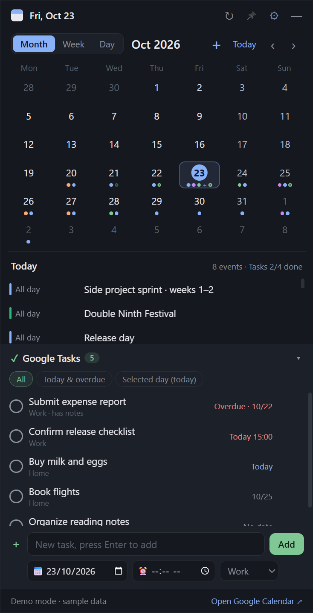
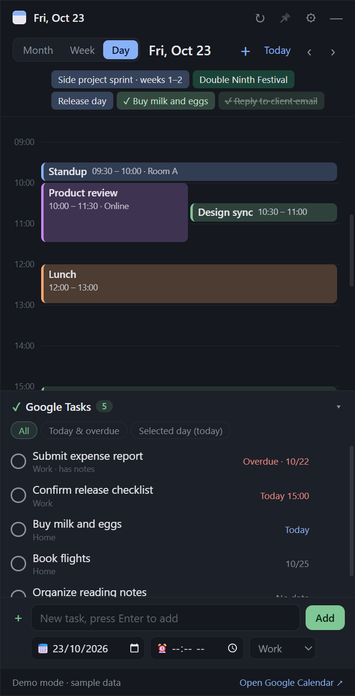
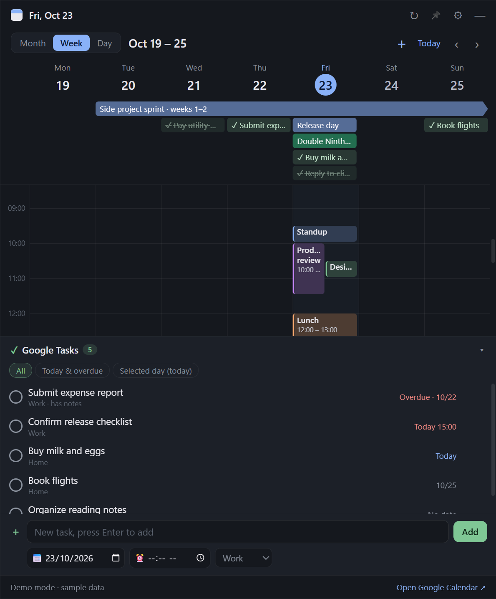
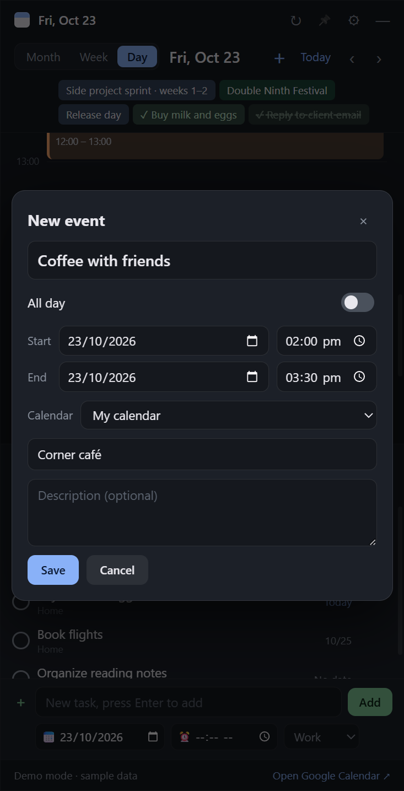
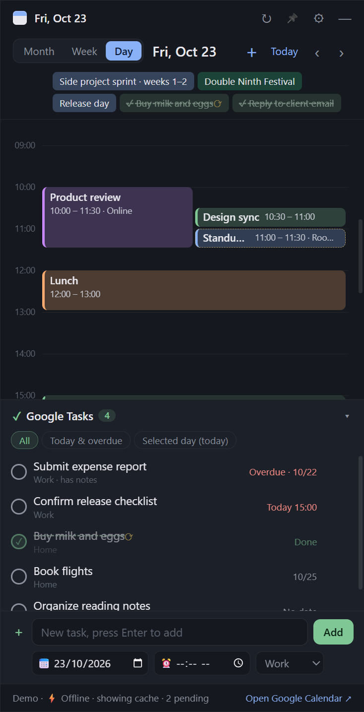

# DeskCalendar · Google Calendar on your desktop

**English** | [中文](README.zh-CN.md)

A Windows desktop widget for **Google Calendar** (month / week / day views) and **Google Tasks**. The interface is available in **English and Chinese**.

**Download**: get `DeskCalendar-x.y.z.exe` from [Releases](../../releases/latest) and double-click it. It's a portable app, so there's nothing to install.

## Screenshots

<table>
  <tr>
    <td align="center"><b>Month view</b><br><sub>Colored dots are events, hollow dots are tasks; the selected day's events and task progress are listed below</sub></td>
    <td align="center"><b>Day view</b><br><sub>24-hour timeline with overlapping events side by side; timed tasks appear on the timeline too</sub></td>
  </tr>
  <tr>
    <td></td>
    <td></td>
  </tr>
  <tr>
    <td align="center" colspan="2"><b>Week view</b><br><sub>Multi-day events as bars (with an arrow when they continue into next week); completed tasks are struck through</sub></td>
  </tr>
  <tr>
    <td colspan="2" align="center"></td>
  </tr>
  <tr>
    <td align="center"><b>New event</b><br><sub>Drag across empty time to create an event with the start and end filled in</sub></td>
    <td align="center"><b>Offline mode</b><br><sub>Keep editing without a connection; items marked ⟳ sync automatically when you're back online</sub></td>
  </tr>
  <tr>
    <td></td>
    <td></td>
  </tr>
</table>

> Screenshots show sample data from demo mode (`npm run demo`). Regenerate them in both languages with `npm run screenshots`.

## Features

- **Month view**: a 6-week grid with colored dots for events (matching your Google Calendar colors) and a hollow green dot for days with tasks due. Click a day to list its events below; double-click to open the day view.
- **Week view**: Monday–Sunday time grid. Multi-day all-day events are drawn as bars spanning the days, with an arrow if they continue into the next week. Tasks due that day appear in the all-day row, and a current-time line runs through today's column. Click a date in the header to open that day. The window widens to 600 px if it's too narrow for the week view. (The Chinese interface also shows lunar dates.)
- **Day view**: 24-hour timeline with overlapping events side by side, an all-day row for all-day events and tasks due that day, and a red current-time line when viewing today.
- **Google Tasks**: all open tasks from all your task lists, sorted by due date, overdue ones in red. Filter by All / Today & overdue / Selected day. **Click the circle to complete a task** (synced back to Google).
- **New tasks**: type in the box at the bottom of the task panel and press Enter. Optionally set a due date (defaults to the day selected on the calendar), a time and a task list. The box stays available when the task list is collapsed.
- **Delete tasks**: hover a task and click 🗑, or open its details and click Delete. Both ask you to click again to confirm. Deleting syncs to Google Tasks (subtasks are deleted too) and can't be undone in the widget.
- **Tasks on the calendar**: tasks with a time are drawn on the day / week timeline (green, dashed border; open them to complete). Tasks with only a date go in the all-day row. In month view, the selected day lists its tasks with progress, such as "Tasks 2/5 done".
- **Completion history**: completed tasks stay on the calendar, struck through with a dashed line, so you can look back at what got done. Completed tasks without a due date appear on the day they were completed. Click ✓ again to mark a task incomplete. The task panel's All / Today & overdue filters show only open tasks (ones you just checked off stay, struck through, until the next refresh); Selected day shows all of that day's tasks.
- **New events**: click ＋ in the toolbar, or click empty space in the day / week view (creates a 1-hour event) or drag across a time range. Set title, all day, start / end, calendar, location and description.
- **Edit / delete events**: open an event and use Edit or Delete (Delete asks you to click again to confirm).
- **Drag to reschedule**: in the day / week view, drag an event up or down to change its time (snaps to 15 minutes), sideways in the week view to change the day, or drag its bottom edge to change the end time. Timed tasks can be dragged too. Changes are saved to Google right away.
- **Works offline**: events and tasks are cached locally. On startup and when you navigate, cached data is shown immediately and refreshed in the background. Without a connection you can still create, edit, drag, delete and complete; changed items get a ⟳ mark and the status bar shows "Offline · N pending". Pending changes are saved in order on disk (they survive closing the app) and uploaded automatically when the connection returns: checked every 30 seconds, and immediately when the PC wakes up or Windows reports it's back online. When the network is fine, changes go straight to Google.
  - If Google rejects a change during upload (for example, the calendar has become read-only), that change is discarded and a message is shown. Items that were deleted elsewhere are skipped silently.
  - Signing out clears the local cache and any changes not yet uploaded.
- **English / 中文**: Settings → "语言 / Language": System default (Chinese on Chinese systems, English otherwise), 中文 or English. The change applies immediately to text, date formats, weekday names, error messages and the tray menu. Native date / time inputs follow the language after a restart.
- **Start with Windows**: on by default; turn it off in Settings or the tray menu. Keep the portable EXE in a fixed location. If you move it, run it once so the startup entry points to the new place.
- Frameless window you can move and resize (position and size are remembered). Closing hides it to the tray. Optional keep-on-top and opacity. Syncs every 5 minutes.

## Running

Double-click `release/DeskCalendar-1.7.0.exe` (portable, no install).

From source (requires Node.js):

```bash
npm install
npm start          # normal start
npm run demo       # sample data, no sign-in needed
```

> If Electron fails to download during `npm install` (no `electron.exe` in `node_modules/electron/dist`), set a mirror and run the installer again, e.g. `set ELECTRON_MIRROR=https://npmmirror.com/mirrors/electron/` then `node node_modules/electron/install.js`.

## Connecting Google for the first time (about 5 minutes, once)

Google requires apps that use the Calendar / Tasks APIs to have their own OAuth client, so you create one (free) in your own Google Cloud project.

1. Open the [Google Cloud console](https://console.cloud.google.com/projectcreate) and create a project.
2. In the API Library, enable the [Google Calendar API](https://console.cloud.google.com/apis/library/calendar-json.googleapis.com) and the [Google Tasks API](https://console.cloud.google.com/apis/library/tasks.googleapis.com).
3. Open [Google Auth Platform](https://console.cloud.google.com/auth/overview): enter an app name and email, choose the **External** audience, and add your own Gmail under Audience → Test users.
4. Under Clients, create an OAuth client with **application type "Desktop app"** and download its JSON file.
5. In DeskCalendar, open ⚙ Settings → **Import client JSON** → **Sign in with Google**, then pick your account in the browser and allow access.

The Settings panel links to each of these pages. When sign-in finishes, the browser shows "Signed in ✓" and your events and tasks appear in the widget.

**Troubleshooting: "has not completed the Google verification process … Error 403: access_denied"**

Your app is in "Testing" and the Gmail you signed in with isn't on its test-user list. Either:

- **Add yourself as a test user**: open [Google Auth Platform → Audience](https://console.cloud.google.com/auth/audience) (check the right project is selected at the top left), click Add users under Test users, enter your Gmail, save, and click Sign in with Google again.
- **Publish the app**: on the same page, click Publish app and confirm. No review is needed for personal use. When signing in, Google will say "Google hasn't verified this app"; click Advanced → Go to … (unsafe). A published app also stops the sign-in from expiring every 7 days.

**Notes**

- Permissions requested: read calendars (`calendar.readonly`), edit events (`calendar.events`, for creating / editing / deleting / dragging events), and read/write tasks (`tasks`).
- **Version 1.4.0 added the edit-events permission.** If you signed in before that, sign out and sign in again in Settings to edit events (viewing works either way).
- While the app is in "Testing", Google may ask you to sign in again every 7 days; the status bar will tell you, and you just click Sign in with Google again. Publishing the app (no review needed for personal use) avoids this.
- All calendars you've checked as visible in Google Calendar are shown.

## Privacy

- The client JSON and sign-in tokens are encrypted with Windows (Electron `safeStorage`) in `%APPDATA%\desk-calendar\secrets.bin` and never leave this PC. The event / task cache and pending changes are encrypted in `cache.bin` in the same folder.
- Sign-in uses your system browser with a local `127.0.0.1` callback, PKCE and a random state check; the app never sees your Google password.
- The interface process is sandboxed with context isolation and can't read the tokens. Data is only sent to Google's official APIs.

## Development

```bash
npm test             # unit tests: dates / timeline layout, OAuth, offline sync, translation completeness, …
npm run smoke        # drives the real window in demo mode (incl. offline and language switching), screenshots to artifacts/
npm run screenshots  # regenerates the README screenshots in both languages into docs/screenshots/
npm run build        # builds the portable Windows EXE into release/
```

```
src/main.js                    main process: window, tray, encrypted storage, IPC
src/google.js                  OAuth (PKCE + loopback) and the Calendar / Tasks APIs
src/store.js                   offline-first data layer: local cache, pending-change queue, retry on reconnect
src/demo.js                    sample data and a fake Google service (can simulate being offline)
src/preload.js                 secure bridge (contextBridge)
src/renderer/i18n.js           English / Chinese strings (shared by main process and UI)
src/renderer/index.html        UI
src/renderer/app.js            month / week / day views and the task panel
src/renderer/editing.js        event editing and dragging
src/renderer/calendar-core.js  date math, timeline layout, lunar dates
```

To add text, add an entry to both `zh` and `en` in `src/renderer/i18n.js`; `npm test` checks that both languages have the same keys and placeholders.

## Limitations

- Only timed events and timed tasks can be dragged; change all-day events' dates with Edit. An event can't be moved to another calendar while editing.
- Editing, dragging or deleting a recurring event affects only that occurrence, not the whole series.
- Read-only calendars (holidays, calendars shared with you as read-only) can't be edited or dragged.
- The Google Tasks API stores only a due date, not a time. DeskCalendar writes the time on the first line of the task's notes (for example `⏰ 15:30`), so it syncs with the task and shows in the notes in Google Tasks on your phone or the web, but Google's own apps won't use it as a reminder time. Writing `⏰ HH:MM` on the first line of a note yourself also works.
- It's a regular desktop window, not embedded in the wallpaper: other windows can cover it unless Keep on top is on, and Win+D hides it (reopen it from the tray icon).
