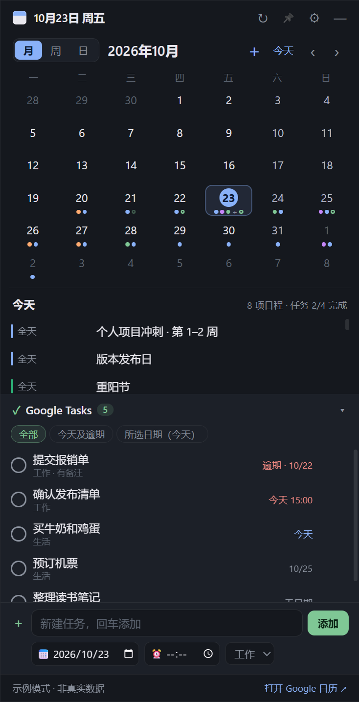
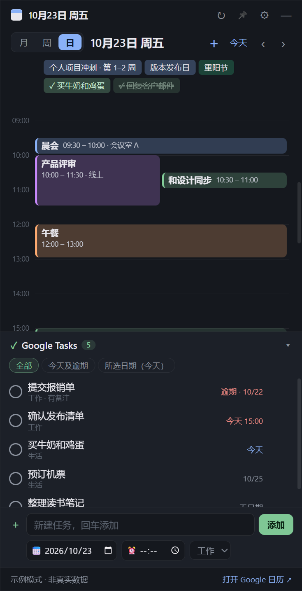
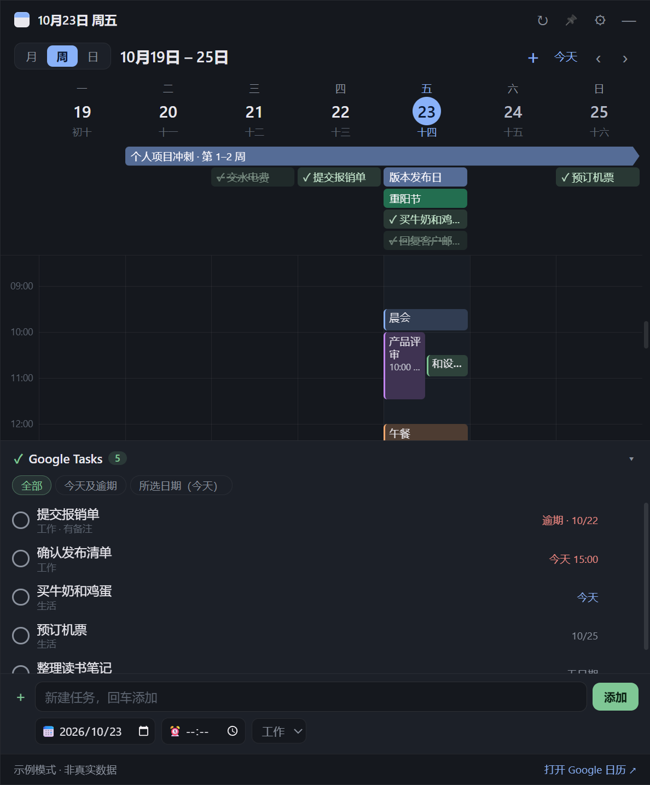
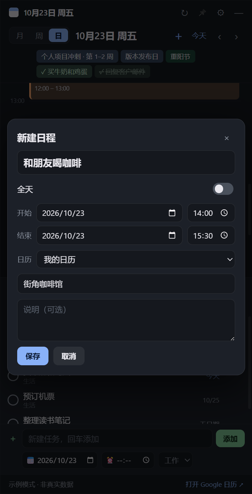
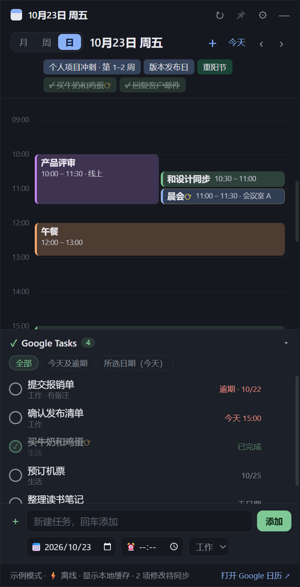

# DeskCalendar · 桌面 Google 日历

Windows 桌面小组件：在桌面上显示 **Google 日历**（月视图 / 周视图 / 日视图）和 **Google Tasks**。

**下载**：到 [Releases](../../releases/latest) 下载 `DeskCalendar-x.y.z.exe`，双击即可运行（便携版，免安装）。

## 截图

<table>
  <tr>
    <td align="center"><b>月视图</b><br><sub>彩色圆点表示日程，空心圆表示任务；下方列出所选日期的日程和任务完成情况</sub></td>
    <td align="center"><b>日视图</b><br><sub>24 小时时间轴，重叠日程并排；带时间的任务也在时间轴上</sub></td>
  </tr>
  <tr>
    <td></td>
    <td></td>
  </tr>
  <tr>
    <td align="center" colspan="2"><b>周视图</b><br><sub>农历日期、跨天日程长条（延续到下周带箭头）、已完成任务虚线划掉</sub></td>
  </tr>
  <tr>
    <td colspan="2" align="center"></td>
  </tr>
  <tr>
    <td align="center"><b>新建日程</b><br><sub>在空白时间段拖出一段时间，自动填好开始和结束</sub></td>
    <td align="center"><b>离线模式</b><br><sub>断网时照常修改，带 ⟳ 的条目会在网络恢复后自动同步</sub></td>
  </tr>
  <tr>
    <td></td>
    <td></td>
  </tr>
</table>

> 截图为示例模式（`npm run demo`）中的示例数据。重新生成截图：`npm run screenshots`。

## 功能

- **月视图**：6 周月历，日程用彩色圆点标出（颜色和 Google 日历一致），绿色空心圆表示当天有到期任务；点击日期，下方列出当天日程；双击日期进入日视图。
- **周视图**：周一到周日 7 列时间网格，表头显示日期和农历（初一显示月份）；跨天的全天日程画成横跨多天的长条，延续到下周的带箭头；当天到期的任务也显示在全天栏；当前时间线画在今天那一列；点击表头的日期进入那天的日视图。切换到周视图时，窗口太窄会自动加宽到 600px。
- **日视图**：24 小时时间轴；时间重叠的日程并排显示；顶部一行显示全天日程和当天到期的任务；看今天时有一条红色的当前时间线。
- **Google Tasks**：汇总所有任务列表中未完成的任务，按截止日期排序，逾期的标红；可以按“全部 / 今天及逾期 / 所选日期”筛选；**点圆圈即可标记完成**（会同步回 Google）。
- **删除任务**：鼠标移到任务列表中的任务上，点右侧的 🗑；或点开任务详情点「删除」。都需要再点一次确认。删除会同步到 Google Tasks（子任务一并删除），无法在组件里撤销。
- **新建任务**：任务面板底部的输入框，回车添加；可选截止日期（默认是日历上选中的那天）、完成时间和任务列表。任务面板折叠时输入框仍然可用。
- **任务显示在日历上**：设置了完成时间的任务按时间画在日视图 / 周视图的时间轴上（绿色虚线边框，点开可标记完成）；只有日期的任务显示在全天栏；月视图点某天时，日程下方也会列出当天的任务，并显示完成进度（如“任务 2/5 完成”）。
- **新建日程**：点工具栏的「＋」；或在日视图 / 周视图的空白处点一下（新建 1 小时）、按住拖出一段时间。可以设置标题、全天、开始 / 结束时间、日历、地点和说明。
- **编辑 / 删除日程**：点开日程，用「编辑」或「删除」（删除需要再点一次确认）。
- **拖拽改时间**：在日视图 / 周视图里按住日程上下拖动改时间（15 分钟对齐），在周视图左右拖动改日期；拖日程的底边改结束时间。带时间的任务也能拖动。修改会直接保存到 Google。
- **完成记录**：任务完成后不会从日历上消失，而是显示为虚线划掉，方便回看每天的完成情况；没有截止日期的已完成任务显示在完成那天。再点一次 ✓ 可以恢复为未完成。任务面板的“全部 / 今天及逾期”只列未完成的任务（刚勾掉的会划掉保留到下次刷新），“所选日期”列出当天的全部任务。
- 无边框窗口，可拖动、可调整大小，并记住位置和大小；关闭后收到系统托盘；可设置窗口置顶和不透明度；每 5 分钟自动同步。
- **离线可用**：日程和任务会缓存在本机。启动或翻页时先立即显示缓存，再在后台联网更新。连不上 Google 时，新建、修改、拖动、删除、完成等操作照常进行，修改后的条目带 ⟳ 标记，底部显示“离线 · N 项修改待同步”；这些修改按顺序保存在本机（关掉程序也不会丢）。网络恢复后（每 30 秒检测一次，电脑唤醒或系统报告联网时立即检测）自动按顺序上传到 Google；离线新建的条目上传后，之后对它的修改也会正确同步。网络正常时则直接写入 Google。
  - 如果某项修改在上传时被 Google 拒绝（例如日历已变为只读），会放弃这一项并在底部提示；条目已在别处被删除时会静默跳过。
  - 退出登录会清除本地缓存和尚未上传的修改。
- **开机自动启动**：默认开启，可以在 ⚙ 设置或托盘右键菜单中关闭。便携版 EXE 请放在固定位置；移动后运行一次，开机启动会自动更新到新位置。

## 运行

直接双击 `release/DeskCalendar-1.6.0.exe`（便携版，免安装）。

从源码运行（需要 Node.js）：

```bash
npm install
npm start          # 正常启动
npm run demo       # 示例数据，不需要登录
```

> 如果 `npm install` 之后 Electron 下载失败（`node_modules/electron/dist` 里没有 `electron.exe`），可以设置镜像后重新安装：`set ELECTRON_MIRROR=https://npmmirror.com/mirrors/electron/`，然后执行 `node node_modules/electron/install.js`。

## 首次连接 Google（约 5 分钟，只需做一次）

Google 要求使用 Calendar / Tasks API 的应用拥有自己的 OAuth 客户端，因此需要在你自己的 Google Cloud 项目里创建一个（免费）。

1. 打开 [Google Cloud 控制台](https://console.cloud.google.com/projectcreate)，新建一个项目。
2. 在 API 库中启用 [Google Calendar API](https://console.cloud.google.com/apis/library/calendar-json.googleapis.com) 和 [Google Tasks API](https://console.cloud.google.com/apis/library/tasks.googleapis.com)。
3. 打开 [Google Auth Platform](https://console.cloud.google.com/auth/overview)：填写应用名称和邮箱，受众选 **外部**，并在“受众 → 测试用户”中加入你自己的 Gmail 地址。
4. 在“客户端”页面创建 OAuth 客户端，**应用类型选“桌面应用”**，创建后下载 JSON 文件。
5. 打开 DeskCalendar → ⚙ 设置 → **导入客户端 JSON** → **登录 Google**，在浏览器中选择账号并同意授权。

设置面板里也有这些步骤的链接。授权完成后浏览器会显示“授权成功”，回到组件就能看到日程和任务了。

**常见问题：登录时显示“尚未完成 Google 验证流程 … 错误 403：access_denied”**

这是因为应用处于“测试”状态，而你登录用的 Gmail 不在测试用户名单里。二选一：

- **加测试用户**：打开 [Google Auth Platform → 目标对象](https://console.cloud.google.com/auth/audience)（确认左上角选中的是刚才的项目），在“测试用户”中点“添加用户”，填入你登录用的 Gmail，保存后重新点“登录 Google”。
- **发布应用**：在同一页面点“发布应用”并确认。个人使用不需要提交审核；登录时 Google 会提示“Google 尚未验证此应用”，点“高级”→“转至 …（不安全）”即可。发布后不会再每 7 天过期。

**说明**

- 申请的权限：读取日历（`calendar.readonly`）、编辑日程（`calendar.events`，用于新建 / 修改 / 删除 / 拖动日程）、Tasks 读写（`tasks`）。
- **从 1.4.0 起新增了编辑日程的权限**：之前登录过的话，需要在设置里“退出登录”再“登录 Google”一次，才能编辑日程（只读浏览不受影响）。
- 应用处于“测试”状态时，Google 可能每 7 天要求重新登录一次；到时组件底部会提示，在设置里重新点“登录 Google”即可。把应用发布为“正式版”（个人使用无需审核）可以避免这个问题。
- 显示的是你在 Google 日历中勾选显示的所有日历。

## 隐私

- 客户端 JSON 和登录令牌用 Windows 加密（Electron `safeStorage`）保存在 `%APPDATA%\desk-calendar\secrets.bin`，只在本机使用；日程 / 任务缓存和待同步的修改同样加密保存在 `cache.bin`。
- 登录走系统浏览器 + 本机 `127.0.0.1` 回调，使用 PKCE 和随机 state 校验；应用本身不接触你的 Google 密码。
- 界面进程启用了沙盒和上下文隔离，拿不到令牌；数据只发送到 Google 官方接口。

## 开发

```bash
npm test           # 日期 / 时间轴布局、OAuth 流程、令牌刷新、分页等单元测试
npm run smoke      # 示例模式启动真实窗口，自动点击检查并截图到 artifacts/
npm run build      # 打包 Windows 便携版 EXE 到 release/
```

```
src/main.js                 主进程：窗口、托盘、加密存储、IPC
src/google.js               OAuth（PKCE + 回环）和 Calendar / Tasks 接口
src/store.js                离线优先数据层：本地缓存、待同步队列、断线重传（有单元测试）
src/preload.js              安全桥接（contextBridge）
src/demo.js                 示例数据
src/renderer/index.html     界面
src/renderer/app.js         月 / 日视图和任务面板
src/renderer/calendar-core.js  日期计算和时间轴布局（有单元测试）
```

## 限制

- 拖动只支持定时日程和带时间的任务；全天日程请用“编辑”修改日期。编辑时不能把日程换到另一个日历。
- 重复日程的编辑、拖动和删除只影响那一次，不会改动整个系列。
- 只读日历（节假日、别人只读共享的日历）不能编辑或拖动。
- Google Tasks 接口只保存截止日期、不保存时间。本组件把完成时间写在任务备注的第一行（如 `⏰ 15:30`），所以时间会随任务同步，在手机或网页的 Google Tasks 里能在备注中看到，但 Google 官方应用不会把它当作提醒时间。在备注第一行手动写上 `⏰ 时:分`，也会被组件识别。
- 这是一个普通的桌面窗口，不是嵌在壁纸层里的；不置顶时会被其他窗口挡住，按 Win+D 会被隐藏，可以从托盘图标重新打开。
